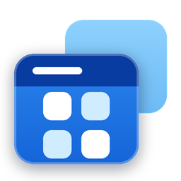
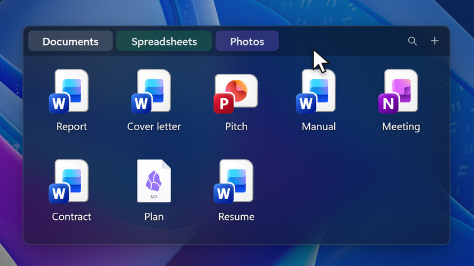
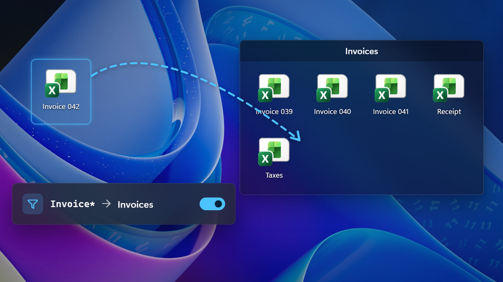
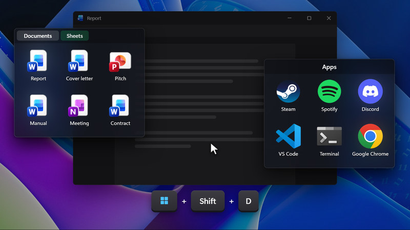
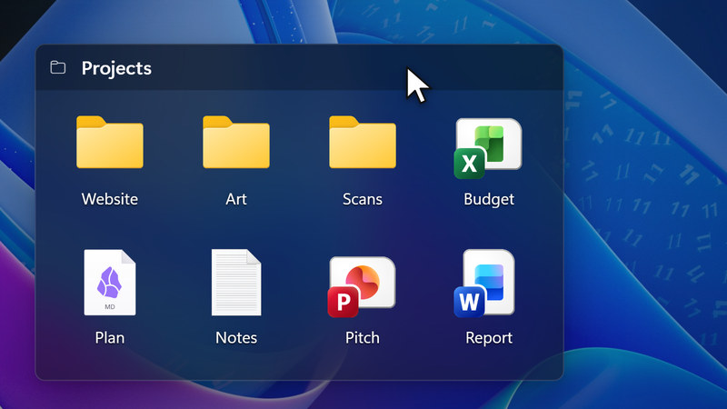

<p align="center">
  <picture>
    <source media="(prefers-color-scheme: light)" srcset="res/settings/home_l.jpg">
    
  </picture>
</p>

<h1 align="center">
  
  <span>Deskboxes</span>
</h1>

<p align="center">
  <span>A desktop organizer for Windows 11. Keep your desktop icons in boxes you can move, roll up, tab and color, and let new files sort themselves.</span>
</p>

<h3 align="center">
  <a href="#-installation">Installation</a>
  <span> · </span>
  <a href="#-features">Features</a>
  <span> · </span>
  <a href="https://github.com/deskboxes/deskboxes/releases">Release notes</a>
  <span> · </span>
  <a href="https://github.com/deskboxes/deskboxes/discussions">Discussions</a>
  <span> · </span>
  <a href="https://github.com/deskboxes/deskboxes/issues/new/choose">Report a bug</a>
</h3>

Deskboxes only changes how your icons are shown. Your files stay where they are, in the Desktop folder, and Explorer, the Recycle Bin and every other program see them exactly as before.

## 🧩 Features

|   |   |   |
|---|---|---|
| 📦 [Boxes](#boxes-and-tabs) | 🗂 [Tabs](#boxes-and-tabs) | ⬆ [Roll-up](#roll-up) |
| 🧭 [Sorting rules](#sorting-rules) | 🎮 [Games box](#sorting-rules) | 🔤 [A–Z index](#everything-deskboxes-does) |
| 📁 [Folder boxes](#folder-boxes) | 📑 [Desktop pages](#desktop-pages) | 🪟 [Boxes above windows](#boxes-above-windows) |
| 🔍 [Search](#search) | 🎨 [Blend into wallpaper](#blend-into-wallpaper) | 🫥 [Hide all](#everything-deskboxes-does) |
| 💾 [Saved layouts](#everything-deskboxes-does) | 🔒 [Locks](#everything-deskboxes-does) | 🕶 [Privacy mode](#everything-deskboxes-does) |
| ↩ [Undo for files](#everything-deskboxes-does) | 🖱 [Windows menus](#everything-deskboxes-does) | 🌐 [English and Polish](#everything-deskboxes-does) |

<table>
<tr>
<td width="50%"><a id="boxes-and-tabs"></a><picture><source media="(prefers-color-scheme: light)" srcset="res/settings/tabs_l.jpg"></picture><br><b>Boxes and tabs</b><br>Group icons into boxes, each with its own color, transparency and blur. Keep several groups in one box and switch between them from its title.</td>
<td width="50%"><a id="roll-up"></a><picture><source media="(prefers-color-scheme: light)" srcset="res/settings/rollup_l.jpg"></picture><br><b>Roll-up</b><br>Fold a box down to its title. It opens when you point at it, click it or double-click its title.</td>
</tr>
<tr>
<td width="50%"><a id="sorting-rules"></a><picture><source media="(prefers-color-scheme: light)" srcset="res/settings/rules_l.jpg"></picture><br><b>Sorting rules</b><br>New icons go into the right box by themselves: by type, name, date, size or where a shortcut leads. Games from Steam, Epic, GOG and other stores get a box of their own.</td>
<td width="50%"><a id="desktop-pages"></a><picture><source media="(prefers-color-scheme: light)" srcset="res/settings/pages_l.jpg"></picture><br><b>Desktop pages</b><br>More desktops side by side, each with its own boxes and icons. Switch with Alt+Left and Alt+Right, a touchpad swipe or by dragging the desktop.</td>
</tr>
<tr>
<td width="50%"><a id="boxes-above-windows"></a><picture><source media="(prefers-color-scheme: light)" srcset="res/settings/above_l.jpg"></picture><br><b>Boxes above windows</b><br>Bring your boxes up over the open windows with Win+Shift+D or a screen corner. No window gets minimized.</td>
<td width="50%"><a id="search"></a><picture><source media="(prefers-color-scheme: light)" srcset="res/settings/search_l.jpg"></picture><br><b>Search</b><br>Start typing on the desktop, or press Ctrl+F, to find any icon, whether loose, in a box or on another page.</td>
</tr>
<tr>
<td width="50%"><a id="blend-into-wallpaper"></a><picture><source media="(prefers-color-scheme: light)" srcset="res/settings/blend_l.jpg"></picture><br><b>Blend into wallpaper</b><br>Icons take on the wallpaper's colors until you point at them, or get a tint of your choice.</td>
<td width="50%"><a id="folder-boxes"></a><picture><source media="(prefers-color-scheme: light)" srcset="res/settings/folder_l.jpg"></picture><br><b>Folder boxes</b><br>Show any folder's files in a box, and open its subfolders right there, with tabs.</td>
</tr>
</table>

### Everything Deskboxes does

- **Boxes.** Move, resize and snap boxes to screen edges and to each other. Each box has its own color, transparency, background blur, icon size and view (icons, list, details, tiles, or covers for games, with Steam's own cover art).
- **Tabs.** Several groups of icons in one box. Drag a box onto another to combine them, or a tab out to make it a box.
- **Roll-up.** A box docked at a screen edge can fold down to its title and open when you point at it.
- **Sorting rules.** File type (documents, images, games, game launchers, installers and more), name, extension, shortcut target, age and size. "Sort now" tidies everything at once; on a new install Deskboxes suggests a set of boxes.
- **A–Z index.** Keep a box in name order with a letter bar for jumping to a letter.
- **Folder boxes.** A folder's files in a box, with navigation into subfolders and tabs.
- **Desktop pages.** More desktops side by side; new files go to the page you're on or the first page.
- **Several monitors.** Boxes and pages on every screen; drag between them. An unplugged screen's boxes wait on the main screen and go back when it returns.
- **Boxes above windows.** A shortcut or a hot corner brings the boxes over your apps; drag from them into an app.
- **Search.** Type anywhere on the desktop to find an icon.
- **Hide all.** Double-click an empty spot to show only the wallpaper.
- **Icon looks.** Tint icons, or let them blend into the wallpaper until you point at them.
- **Saved layouts.** Save how your boxes are arranged and go back to it, or to any of the last seven days.
- **Move to another PC.** Export boxes, pages, rules and settings to one file and import it on the new PC.
- **Locks.** Stop boxes and icons from being moved or resized by accident.
- **Privacy mode.** Hide icon names and pictures when someone is looking over your shoulder.
- **Undo.** Ctrl+Z undoes layout changes and file moves, deletes, copies and renames. Ctrl+Y redoes them.
- **Windows menus.** Right-clicking an icon or the desktop shows Windows' own menu, including the commands other apps add to it, plus Deskboxes' own.
- **Accessible.** Narrator reads the boxes and icons; Tab and F6 move between boxes. Settings has a search box.
- **English and Polish**, following the Windows display language.

## 📦 Installation

**Requirements:** Windows 11, 64-bit, and a GPU with Direct3D 11 (without one, Deskboxes uses Windows' software renderer).

<details open>
<summary><strong>Download the installer from GitHub</strong></summary>
<br>

1. Download **DeskboxesSetup.exe** from the [latest release](https://github.com/deskboxes/deskboxes/releases/latest) (under **Assets**).
2. Run it. It installs for the current user only, in `%LOCALAPPDATA%\Programs\Deskboxes`, and doesn't need administrator rights.

The installer isn't code-signed yet, so Windows SmartScreen may warn you. Choose **More info › Run anyway**. Each release lists the installer's SHA-256 hash, so you can check the download with `Get-FileHash .\DeskboxesSetup.exe`.

Deskboxes starts when you sign in, and installed copies update themselves (Settings › Updates).
</details>

<details>
<summary><strong>Turn off, uninstall, and bring the icons back</strong></summary>
<br>

- **Turn off:** right-click the desktop › Deskboxes › Turn off. To turn it back on, right-click the desktop › Turn on Deskboxes.
- **Uninstall:** Windows Settings › Apps › Installed apps › Deskboxes. Windows' own desktop icons come back as they were.
- **Icons gone?** If Deskboxes ever leaves the desktop without icons, this command brings Windows' own icons back:

  ```powershell
  & "$env:LOCALAPPDATA\Programs\Deskboxes\deskboxes.exe" --restore-icons
  ```
</details>

## ✨ What's new?

See the [release notes](https://github.com/deskboxes/deskboxes/releases) for what changed in each version. The newest one also shows in Settings › Updates.

## 🛣 Roadmap

What comes next is shaped by your ideas and votes: share them in [Discussions](https://github.com/deskboxes/deskboxes/discussions).

## ❤ Community

Found a bug? [Open an issue](https://github.com/deskboxes/deskboxes/issues/new/choose). Have a question or an idea? Start a [discussion](https://github.com/deskboxes/deskboxes/discussions). Thank you to everyone who reports problems and suggests improvements: it makes Deskboxes better for everyone.

## Contributing

Contributions are welcome. Read the [contributing guide](CONTRIBUTING.md) for how to build Deskboxes, test it safely on a fixture desktop, and send a pull request, and for the terms that apply to contributions.

## License

Deskboxes is **source-available** under the [PolyForm Strict License 1.0.0](LICENSE.md). You may read, build and use the code for noncommercial purposes, but not redistribute it or publish changed versions. Contributions are accepted under the terms in [CONTRIBUTING.md](CONTRIBUTING.md). Third-party components are listed in [THIRD_PARTY_NOTICES.md](THIRD_PARTY_NOTICES.md).

## Code of conduct

This project follows the [Contributor Covenant](CODE_OF_CONDUCT.md).

## Privacy statement

Deskboxes collects no telemetry. Nothing about your desktop, files or usage is sent anywhere. It makes one kind of network request: a daily update check against this repository's [releases](https://github.com/deskboxes/deskboxes/releases), which you can turn off in Settings › Updates.

| What | Where |
| --- | --- |
| Settings, box layouts, saved layouts | `%APPDATA%\Deskboxes` |
| Icon cache and logs | `%LOCALAPPDATA%\Deskboxes` |
